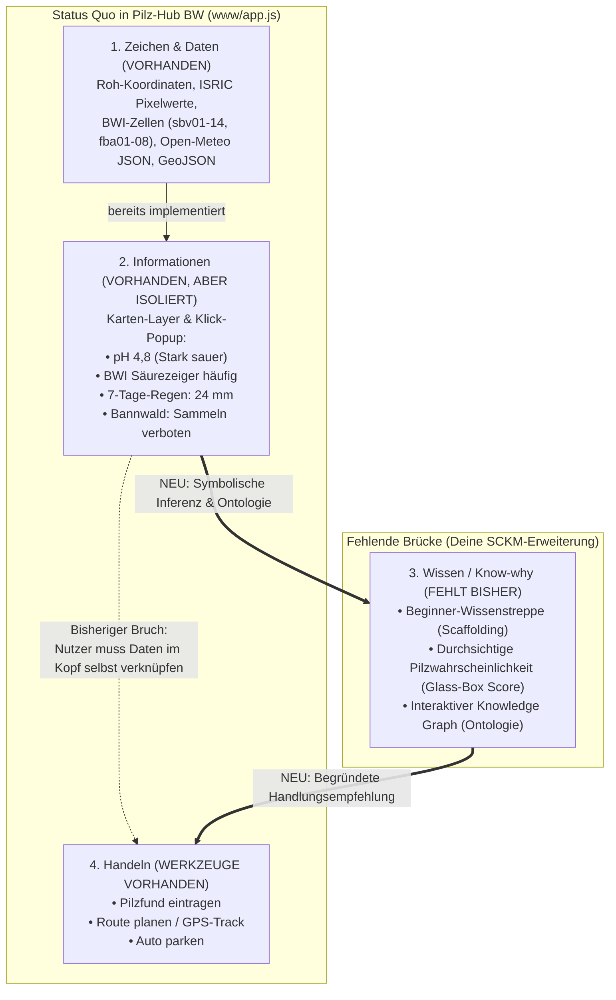

# SCKM-Integrationsplan: Beginner-Wissenstreppe, Glass-Box Pilzwahrscheinlichkeit & Knowledge Graph in `PilzMap_Eigen`

> **100 % Isolation vom Original-Projekt (Git & Datenbank):**
> 1. **Git-Repository:** `PilzMap_Eigen` ist eine komplett getrennte lokale Kopie. Der Push auf das Original-Repo (`BlackTeaWonder/PilzMap.git`) ist technisch blockiert (`pushurl = DISABLED_ORIGINAL_REPO_UNTOUCHED`). Bei Bedarf kann `origin` auf ein eigenes Repo unter deinem GitHub-Account (`Drahtesel`) gesetzt werden.
> 2. **Supabase-Cloud-DB:** [`www/app.js`](file:///c:/Studium/9.Semester/Supported/SCKM/PilzMap_Eigen/www/app.js#L738-L740) zeigt auf die Supabase-Instanz der Gruppe. Unsere neuen SCKM-Features (Wissenstreppe, Pilzwahrscheinlichkeit, Knowledge Graph, eigene Standort-Beobachtungen) arbeiten **komplett lokal im Browser (`localStorage` & In-Memory-Geodaten)** und schreiben **nichts** in die Supabase-Datenbank der Gruppe.

---

## 1. Analyse: Inwiefern ist die Wissenstreppe bereits in `PilzMap` enthalten?

In der Vorlesung (*06.10.2026 – Wissen*, [Vorlesungszusammenfassungen S. 6–8](file:///c:/Studium/9.Semester/Supported/SCKM/2026-11-17-Social%20Collab%20Vorlesungszusammenfassungen.pdf)) wird die **Wissenstreppe** (nach North) in Kombination mit den vier Wissensarten (*Know-what, Know-how, Know-why, Know-where*) beschrieben.

### Detailbefund im bestehenden Projekt:
1. **Stufe 1 (Zeichen & Daten) – ✅ Vorhanden:**
   [`www/app.js`](file:///c:/Studium/9.Semester/Supported/SCKM/PilzMap_Eigen/www/app.js) bindet fünf echte Rohdatenquellen für ganz Baden-Württemberg ein: Open-Meteo API, ISRIC SoilGrids WMS, BWI-2002-Inventurdaten ([`Straucher und Boden Vegetation.json`](file:///c:/Studium/9.Semester/Supported/SCKM/PilzMap_Eigen/www/Straucher%20und%20Boden%20Vegetation.json)), ForstBW-Waldrefugien ([`ForstBW_Waldrefugien_-38784724193262813.geojson`](file:///c:/Studium/9.Semester/Supported/SCKM/PilzMap_Eigen/www/ForstBW_Waldrefugien_-38784724193262813.geojson)) und LUBW-Schutzgebiete.
2. **Stufe 2 (Informationen) – ✅ Vorhanden, aber isoliert:**
   Beim Klick auf die Karte (`oeffneKlickPopup` in [`www/app.js#L552-L735`](file:///c:/Studium/9.Semester/Supported/SCKM/PilzMap_Eigen/www/app.js#L552-L735)) werden die Rohdaten bereits in Einzel-Informationen übersetzt (z. B. *„Säurezeiger häufig (pH ~4–4,5)“*, *„pH 4,8 · Stark sauer“*, *„7-Tage-Regen: 18,4 mm“*, *„🚫 Pilze sammeln verboten“*).
   - **Das Problem für Beginner:** Diese Informationsblöcke stehen im Popup unverbunden untereinander. Ein Einsteiger sieht zwar pH-Wert, Regenmenge und Säurezeiger-Pflanzen, weiß aber nicht, **welcher Pilz** dort warum wächst (*Know-why*).
3. **Stufe 3 (Wissen & *Know-why*) – ❌ Fehlt in der Haupt-App (`www/`):**
   - In [`landingpage/index.html`](file:///c:/Studium/9.Semester/Supported/SCKM/PilzMap_Eigen/landingpage/index.html) (*Pilzlotse*) gibt es zwar einen statischen Smartphone-Klickdummy („Deine erste Tour“ in 5 Schritten), dieser arbeitet jedoch nur mit 3 fest einprogrammierten Demo-Wäldern bei Tübingen und ist nicht mit der echten Baden-Württemberg-Karte in `www/` verknüpft.
   - Es gibt in `www/` weder eine **explizite Wissensrepräsentation (Ontologie / Knowledge Graph)** noch eine **transparente Ableitung der Pilzwahrscheinlichkeit (Glass-Box Inferenz)**.
4. **Stufe 4 (Handeln & Kompetenz) – ⚠️ Nur als Roh-Werkzeug vorhanden:**
   Buttons wie *„🚀 Route planen“* oder *„🍄 Pilzfund hier eintragen“* existieren, aber ohne vorgeschalteten Wissens- und Sicherheits-Check (*Metacognitive Scaffolding* / *Desirable Friction* laut Vorlesung vom 17.11.2026).

---

## 2. Daten-Analyse & Maßnahmen für eine lückenlose Punktebewertung

Damit die Glass-Box-Punktebewertung bei **jedem** Klick in Baden-Württemberg sofort und ohne `null`-Werte funktioniert, beheben wir vier konkrete Daten-Engpässe:

| Bewertungs-Faktor | Datenquelle in `PilzMap_Eigen` | Aktueller Engpass in `www/app.js` | Unsere Lösung für lückenlose Bewertung |
| :--- | :--- | :--- | :--- |
| **1. Bodenfeuchte (7-Tage-Regen) & Temperatur** | Open-Meteo API ([`www/app.js#L702`](file:///c:/Studium/9.Semester/Supported/SCKM/PilzMap_Eigen/www/app.js#L702)) | Keiner (wird bei jedem Klick live geladen). | Direkt in die Regel-Engine einspeisen (`< 5 mm` trocken, `15–35 mm` optimal). |
| **2. Schutzgebiete & Sammelrecht** | `naturschutzgebiet.json`, `nationalpark.json`, `waldschutzgebiete.json` | Keiner (standardmäßig aktiv). | Direkt als rechtliche KO-Regel / Hinweis in Stufe 2–4 der Wissenstreppe nutzen. |
| **3. Boden-pH & Zeigerpflanzen** | ISRIC SoilGrids WMS + `Straucher und Boden Vegetation.json` (BWI 2002) | **Layer-Sperre:** `holeBwiAnPunkt` und `holeIsricPhAnPunkt` brechen aktuell mit `return null` ab, wenn die Checkboxen im Layer-Panel nicht manuell aktiviert wurden. | **1. Hintergrund-Abfrage immer aktiv:** BWI-Grid und ISRIC-WMS werden beim Kartenklick **immer** im Hintergrund abgefragt, auch wenn der optische Karten-Layer ausgeschaltet ist. **2. Fallback-Kaskade:** Falls ISRIC für ein Pixel `null` liefert, wird der pH-Wert automatisch aus dem lokalen BWI-Säurezeiger-Score (`sbv01..04`) abgeleitet. |
| **4. Baumarten (Symbiose-Partner)** | `ForstBW_Waldrefugien_...geojson` + BWI (`wald_txt`, `fba01..08`) | `waldLayer` wird beim Klick gar nicht abgefragt; zudem decken Waldrefugien nur ~2 % der Waldfläche ab. | **3-stufige Baumarten-Kaskade:** 1. Point-in-Polygon auf `ForstBW_Waldrefugien` (exakte Baumart). 2. Auswertung der BWI-Zelle (`fba01..08` / `wald_txt`) & pH-plausible Waldbestands-Heuristik. 3. **Human-in-the-Loop (Vor-Ort-Auswahl):** Beginner kann im Panel beobachtete Bäume (*Fichte, Buche, Kiefer, Eiche, Tanne, Birke*) per Chip anklicken/überschreiben. |
| **5. Performance bei 51.000 BWI-Features** | `Straucher und Boden Vegetation.json` | Lineares `eachLayer` mit `turf.booleanPointInPolygon` über alle Features bei jedem Klick. | **Spatial Bounding-Box-Index:** Beim Laden der BW-Features (`bl === 8`) speichern wir `[minLng, minLat, maxLng, maxLat]` im Speicher $\rightarrow$ Punkt-Abfrage dauert `< 2 ms`. |

---

## 3. Geplante Dateiänderungen in `PilzMap_Eigen`

### 1. SCKM-Wissensmodule (`www/sckm/`)
- **`www/sckm/ontology.js`** [NEU]: Strukturierte Pilz-Ontologie (6 kontrastierende Pilzarten: *Fichten-Steinpilz, Maronen-Röhrling, Echter Pfifferling, Krause Glucke, Sommer-Steinpilz, Speisemorchel*) inkl. Einsteiger-Eignung, pH-Intervall, Mykorrhiza-Baumpartnern, BWI-Zeigerpflanzen, optimalem 7-Tage-Niederschlagsbereich, Hauptsaison, Doppelgänger-Warnungen sowie den 4 Stufen der Beginner-Wissenstreppe.
- **`www/sckm/inferenceEngine.js`** [NEU]: `evaluateLocationKnowledge(standortDaten, zielPilzId)` – Verknüpft die Live-Daten eines geklickten Kartenpunkts (`phWert`, BWI-Säurezeiger `sbv01..04`, `baumarten`, `regen7TageMm`, `schutzgebiete`) zum transparenten Glass-Box-Eignungsscore (`0–100 %`) entlang der 4 Stufen der Wissenstreppe.
- **`www/sckm/knowledgeGraph.js`** [NEU]: Interaktiver SVG-Wissensgraph mit 4 semantischen Spalten (*1. Boden-Milieu (pH)*, *2. Symbiose-Baum*, *3. Pilzart (Regelwerk)*, *4. Zeigerpflanze & Feuchte*) und direkter Karten-Layer-Kopplung.
- **`www/sckm/wissenstreppeUI.js`** [NEU]: UI-Controller für das Beginner-Wissenstreppen-Panel, die interaktive Vor-Ort-Beobachtung, Referenz-Standorte für den Schnellstart und das Knowledge-Graph-Dock.
- **`www/sckm/sckm.css`** [NEU]: Eigenständiges Stylesheet im Design-System von `Pilz-Hub BW` (`#2ca25f` Grün-Akzente, Frosted-Glass-Optik, responsive für Desktop & Mobile).

### 2. Minimale, nicht-invasive Integration in `Pilz-Hub BW`
- **[`www/index.html`](file:///c:/Studium/9.Semester/Supported/SCKM/PilzMap_Eigen/www/index.html)** [MODIFY]: Einbinden von `sckm/sckm.css` und der 4 neuen Skripte sowie Ergänzen des Floating Action Buttons `🪜` im `#fab-container` und der Container `#wissenstreppe-panel` / `#knowledge-graph-dock`.
- **[`www/app.js`](file:///c:/Studium/9.Semester/Supported/SCKM/PilzMap_Eigen/www/app.js)** [MODIFY]: Aufbau des schnellen In-Memory-Bounding-Box-Index (`window._bwiFeaturesIndex` & `window._waldFeaturesIndex`) für hintergrundfähige Punkt-Abfragen ohne Layer-Sichtbarkeitszwang; Übergabe der Standortdaten in `oeffneKlickPopup(latlng)` an `window.aktualisiereSckmStandort(...)` inkl. kompakter Glass-Box-Vorschau im Popup.
